# CargaPrime

**Plataforma B2B full-stack para logística e fornecimento industrial.**  
Projeto final desenvolvido no âmbito do Curso Avançado em Desenvolvimento Web — Master D.

## Capturas reais

Interfaces reais da versão CargaPrime 3.6.3, capturadas em ambiente local com uma base de dados temporária de demonstração. Cada vista inclui desktop e mobile; clique numa imagem para a abrir por inteiro.

### Página inicial

Identidade visual, menu e apresentação da plataforma B2B.

<table>
<thead><tr><th width="70%">Desktop</th><th width="30%">Mobile</th></tr></thead>
<tbody><tr>
<td></td>
<td><a href="docs/mobile-01-inicio.jpg">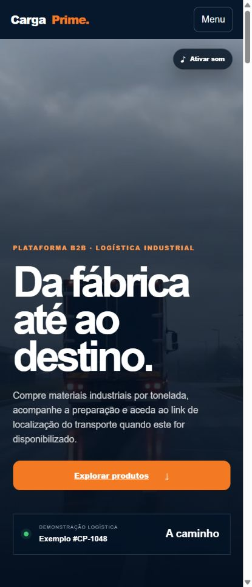</a></td>
</tr></tbody>
</table>

### Catálogo

Consulta do catálogo com pesquisa, categorias e disponibilidade.

<table>
<thead><tr><th width="70%">Desktop</th><th width="30%">Mobile</th></tr></thead>
<tbody><tr>
<td><a href="docs/desktop-02-catalogo.jpg">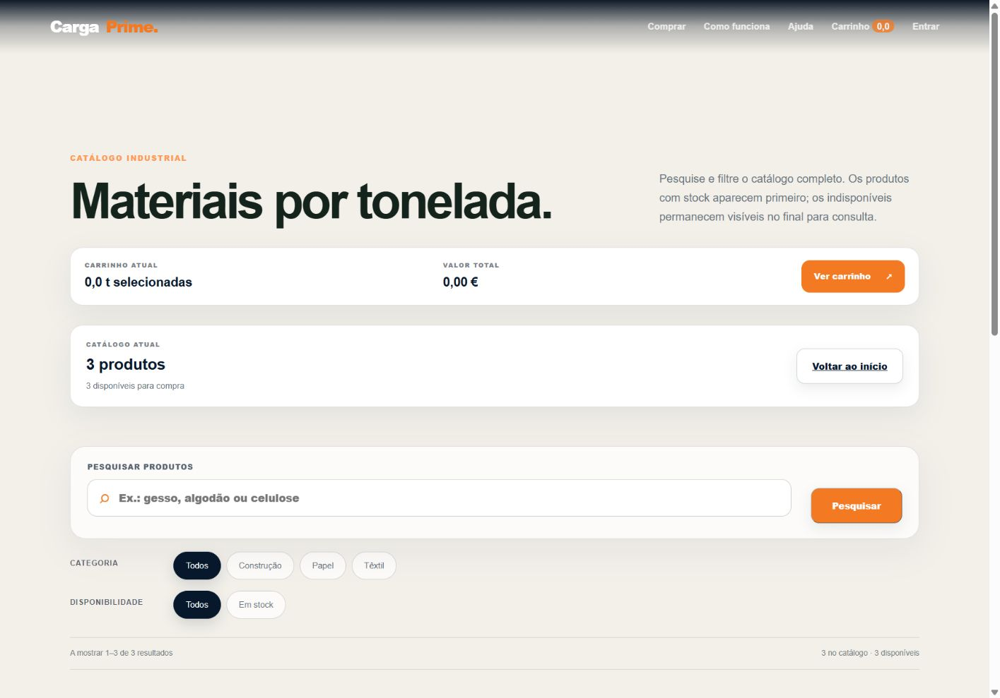</a></td>
<td><a href="docs/mobile-02-catalogo.jpg">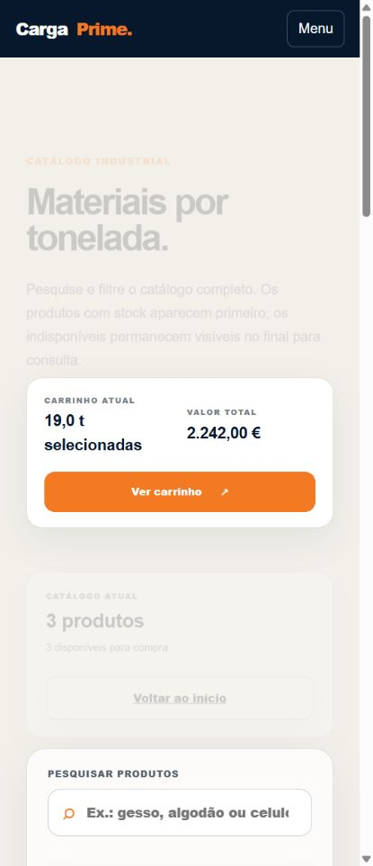</a></td>
</tr></tbody>
</table>

### Produtos industriais

Cartões reais de produto com imagem, stock, preço por tonelada e quantidade.

<table>
<thead><tr><th width="70%">Desktop</th><th width="30%">Mobile</th></tr></thead>
<tbody><tr>
<td><a href="docs/desktop-03-produtos.jpg">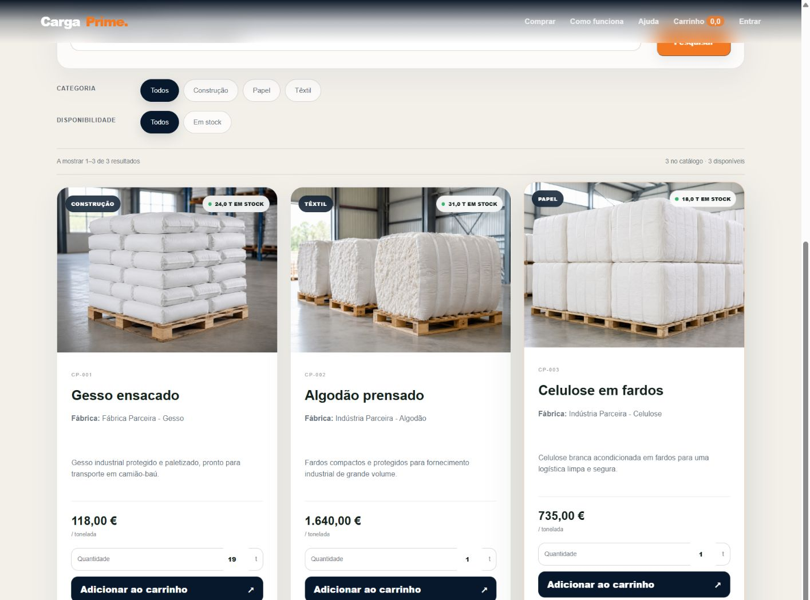</a></td>
<td><a href="docs/mobile-03-produtos.jpg">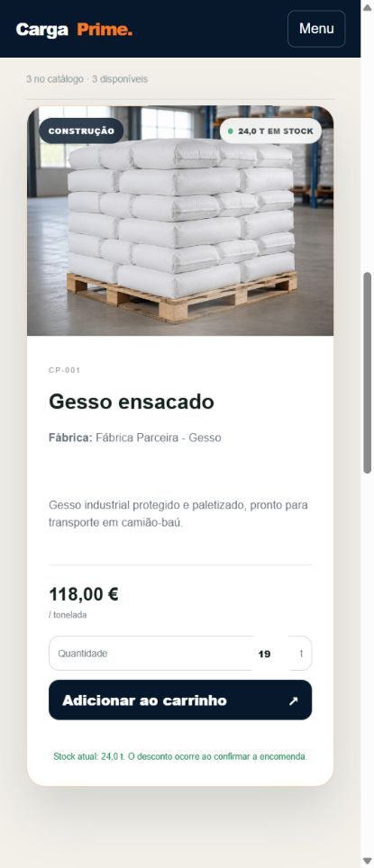</a></td>
</tr></tbody>
</table>

### Pesquisa e filtros

Pesquisa por “gesso” com categoria Construção, devolvendo um resultado.

<table>
<thead><tr><th width="70%">Desktop</th><th width="30%">Mobile</th></tr></thead>
<tbody><tr>
<td><a href="docs/desktop-04-pesquisa-filtros.jpg">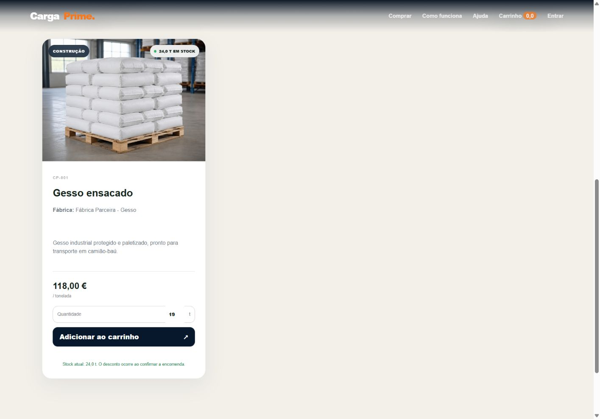</a></td>
<td><a href="docs/mobile-04-pesquisa-filtros.jpg">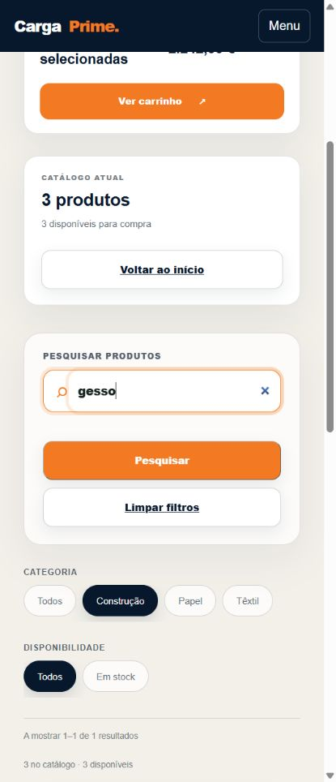</a></td>
</tr></tbody>
</table>

### Carrinho de demonstração

Seleção de 19 t de gesso numa sessão de visitante. Nenhuma encomenda foi confirmada e o stock não foi descontado.

<table>
<thead><tr><th width="70%">Desktop</th><th width="30%">Mobile</th></tr></thead>
<tbody><tr>
<td><a href="docs/desktop-05-carrinho.jpg">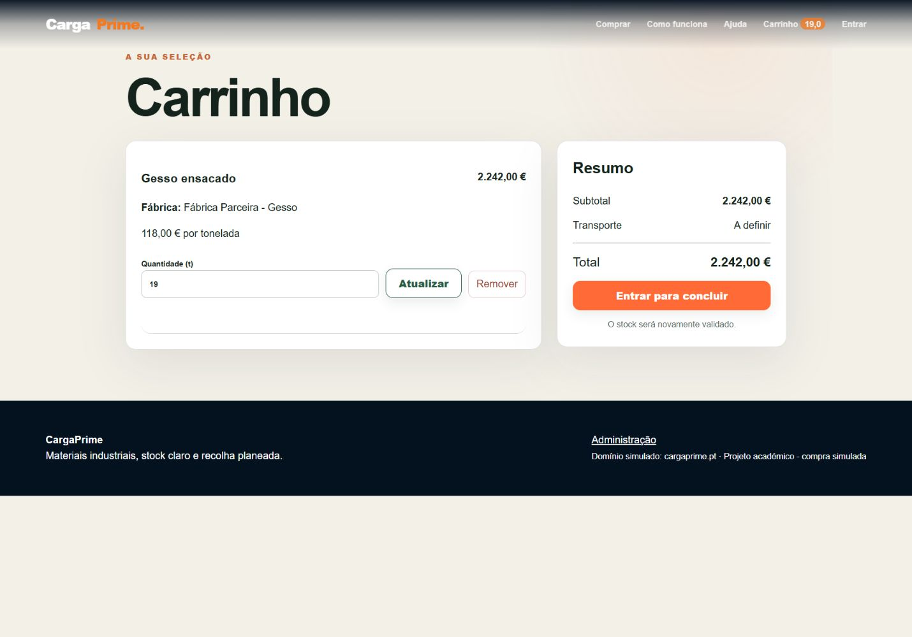</a></td>
<td><a href="docs/mobile-05-carrinho.jpg">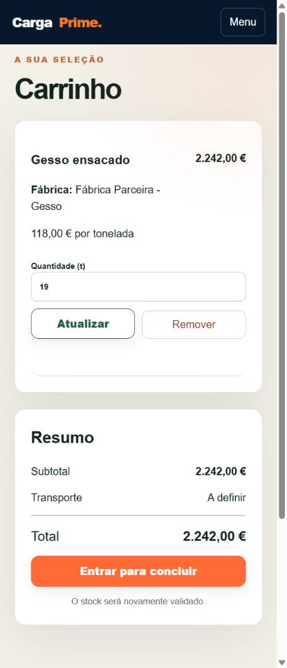</a></td>
</tr></tbody>
</table>

### Iniciar sessão

Formulário vazio de autenticação; acesso reservado a clientes e administração.

<table>
<thead><tr><th width="70%">Desktop</th><th width="30%">Mobile</th></tr></thead>
<tbody><tr>
<td></td>
<td><a href="docs/mobile-06-login.jpg">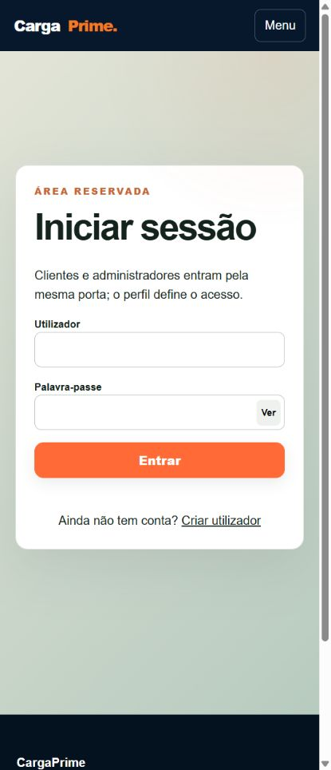</a></td>
</tr></tbody>
</table>

### Dashboard administrativo

Painel autenticado com resumo, encomendas recentes e gestão de produtos. A base temporária tem zero encomendas e três produtos.

<table>
<thead><tr><th width="70%">Desktop</th><th width="30%">Mobile</th></tr></thead>
<tbody><tr>
<td><a href="docs/desktop-07-administracao.jpg">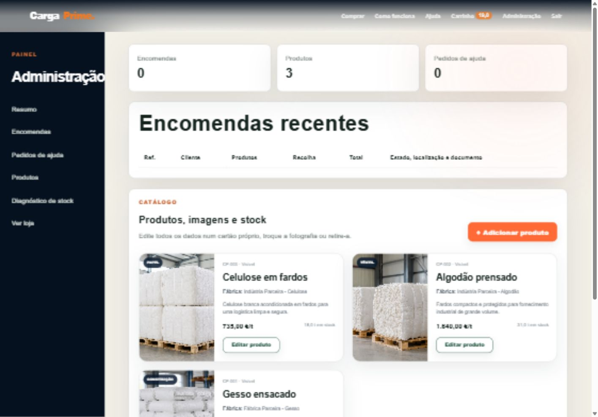</a></td>
<td><a href="docs/mobile-07-administracao.jpg">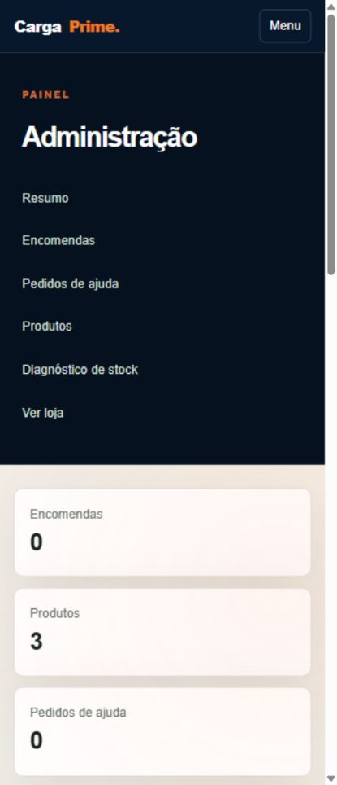</a></td>
</tr></tbody>
</table>

### Diagnóstico de stock

Leitura dos valores reais da base temporária: gesso 24 t, algodão 31 t e celulose 18 t.

<table>
<thead><tr><th width="70%">Desktop</th><th width="30%">Mobile</th></tr></thead>
<tbody><tr>
<td><a href="docs/desktop-08-stock.jpg">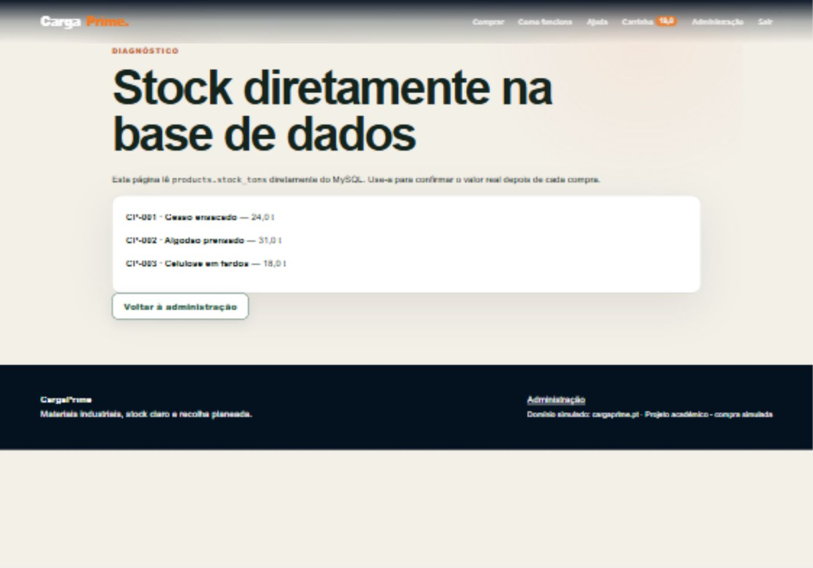</a></td>
<td><a href="docs/mobile-08-stock.jpg">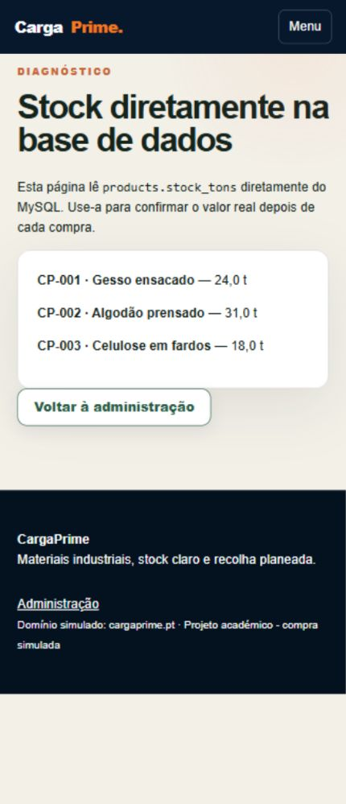</a></td>
</tr></tbody>
</table>

### Gestão de produto e stock

Formulário de edição aberto para documentar nome, categoria, origem, imagem, preço, stock e visibilidade. Nenhuma alteração foi guardada.

<table>
<thead><tr><th width="70%">Desktop</th><th width="30%">Mobile</th></tr></thead>
<tbody><tr>
<td><a href="docs/desktop-09-gestao-produto.jpg">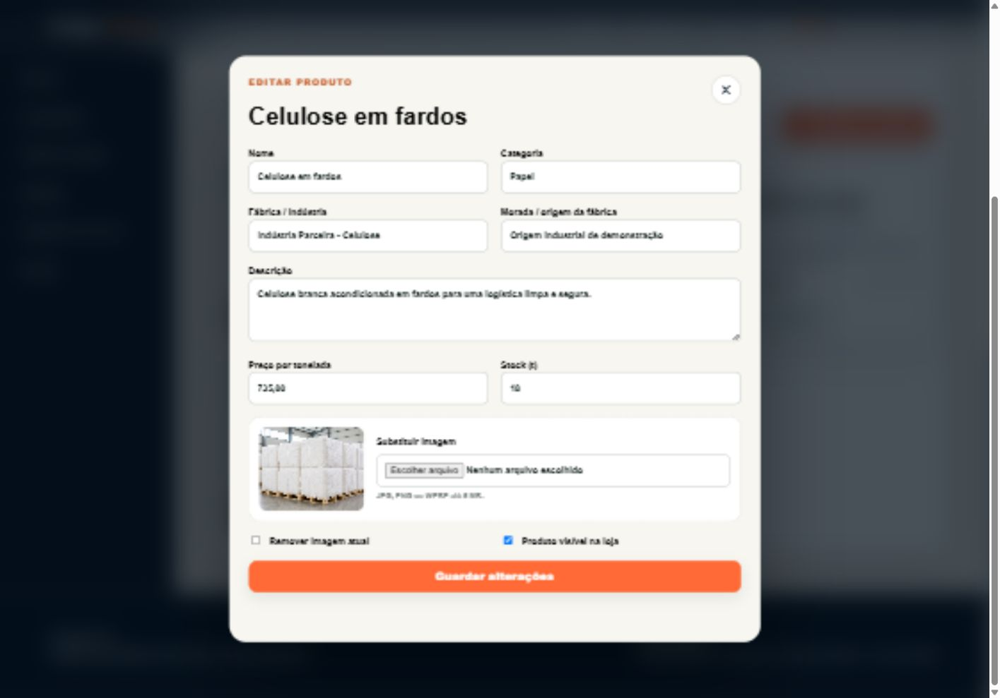</a></td>
<td><a href="docs/mobile-09-gestao-produto.jpg">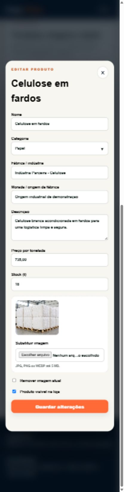</a></td>
</tr></tbody>
</table>

### Registo de cliente

Formulário de criação de conta, capturado vazio. A conta fictícia usada depois foi criada apenas na base temporária.

<table>
<thead><tr><th width="70%">Desktop</th><th width="30%">Mobile</th></tr></thead>
<tbody><tr>
<td><a href="docs/desktop-10-registo.jpg">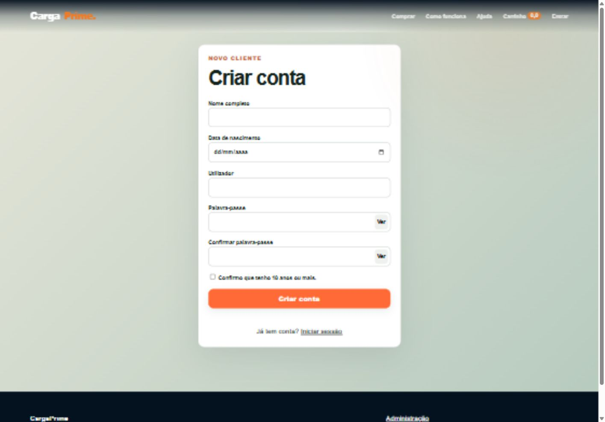</a></td>
<td></td>
</tr></tbody>
</table>

### Área de cliente

Área autenticada de encomendas da conta fictícia. O estado vazio é real; não foram criadas encomendas para preencher a imagem.

<table>
<thead><tr><th width="70%">Desktop</th><th width="30%">Mobile</th></tr></thead>
<tbody><tr>
<td></td>
<td><a href="docs/mobile-11-area-cliente.jpg">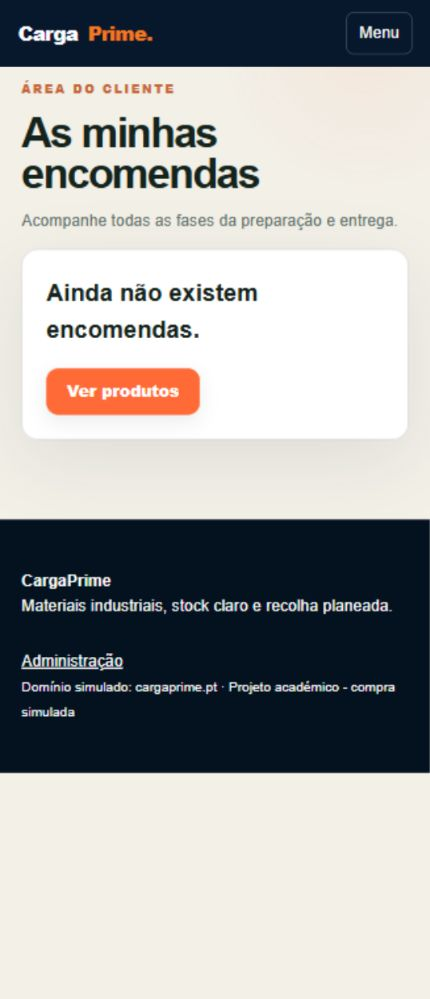</a></td>
</tr></tbody>
</table>

### Checkout de demonstração

Formulário real de encomenda com cliente fictício e carrinho de 19 t. A encomenda não foi confirmada.

<table>
<thead><tr><th width="70%">Desktop</th><th width="30%">Mobile</th></tr></thead>
<tbody><tr>
<td><a href="docs/desktop-12-checkout.jpg">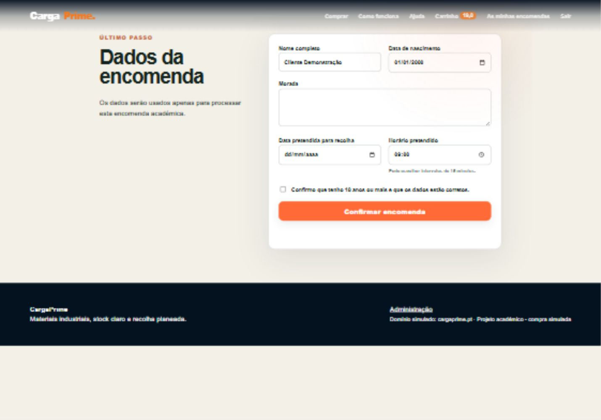</a></td>
<td></td>
</tr></tbody>
</table>

As capturas mostram as interfaces observadas, incluindo os estados vazios reais das encomendas. Não foram confirmadas encomendas, efetuados pagamentos nem guardadas alterações de produto durante esta sessão. Acompanhamento de uma encomenda existente e emissão de documentos de transporte não foram validados nestas capturas. As credenciais não fazem parte das imagens.

## Sobre o projeto

A CargaPrime foi criada a partir de um problema real observado no setor da logística e do fornecimento industrial: informação de produto, stock, encomenda e acompanhamento do transporte pode ficar dispersa entre cliente, fornecedor e operação.

O projeto simula uma plataforma B2B onde clientes empresariais podem consultar materiais industriais, verificar stock, adicionar quantidades ao carrinho, concluir encomendas e acompanhar o respetivo estado.

## Funcionalidades principais

- Catálogo com pesquisa, filtros e paginação no servidor
- Autenticação e perfis de acesso
- Carrinho persistente por utilizador
- Checkout com validação de stock
- Gestão administrativa de produtos, stock e encomendas
- Área de cliente com acompanhamento de encomendas
- Suporte associado ao utilizador e à encomenda
- Documento de transporte
- Integração de link externo para localização/acompanhamento
- SEO técnico, sitemap, robots.txt, Open Graph e JSON-LD

## Destaque técnico

O checkout utiliza **transações MySQL/InnoDB** e `SELECT ... FOR UPDATE` para voltar a validar o stock no momento da confirmação da compra. Isso evita que duas encomendas consumam simultaneamente as mesmas unidades disponíveis.

## Tecnologias

`PHP` · `MySQL` · `JavaScript` · `HTML5` · `CSS3` · `PDO` · `AJAX`

**Ferramentas:** Figma · XAMPP · phpMyAdmin · VS Code

## Segurança implementada

- `password_hash` / `password_verify`
- Prepared statements com PDO
- Tokens CSRF
- Regeneração de sessão no login
- Escape de saída HTML
- Controlo de acesso por função
- Validação no cliente e no servidor
- Transações para consistência do stock

## Resultados de validação

Na validação final documentada do projeto:

- W3C Nu HTML Checker: **0 erros e 0 avisos**
- Lighthouse: **Performance 76 · Accessibility 96 · Best Practices 100 · SEO 100**

## Instalação local

1. Copiar a pasta do projeto para `C:\xampp\htdocs\`.
2. Iniciar Apache e MySQL no XAMPP.
3. Importar `database/cargaprime_db.sql` no phpMyAdmin.
4. Confirmar a porta MySQL em `config/database.php`.
5. Abrir o projeto no navegador através do `localhost`.

### Conta de demonstração

- Utilizador: `admin`
- Palavra-passe: `Admin@123`

> Estas credenciais existem apenas para demonstração local do projeto académico.

## Design

O projeto foi planeado com wireframes mobile/desktop e style guide em Figma.

## Estrutura

- `admin/` — gestão administrativa
- `api/` — endpoints usados por AJAX e sincronização de stock
- `assets/` — CSS, JavaScript, imagens e media
- `config/` — configuração e ligação à base de dados
- `database/` — estrutura e dados iniciais MySQL
- `docs/` — documentação técnica e testes
- `includes/` — componentes e funções reutilizáveis

## Contexto

Projeto académico e demonstrativo. O domínio `cargaprime.pt` é utilizado apenas como referência simulada no trabalho de SEO e não representa um serviço comercial ativo.
